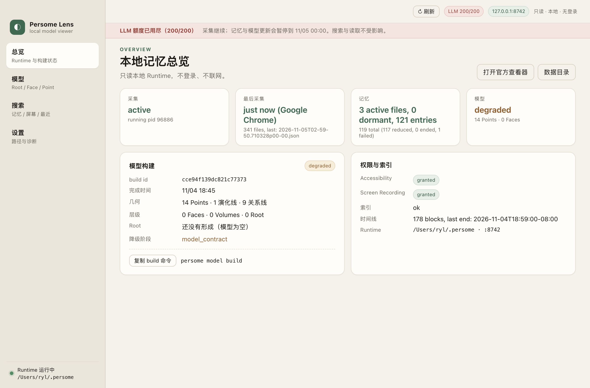
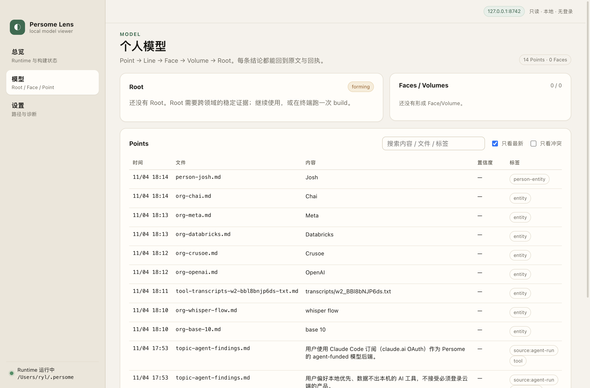
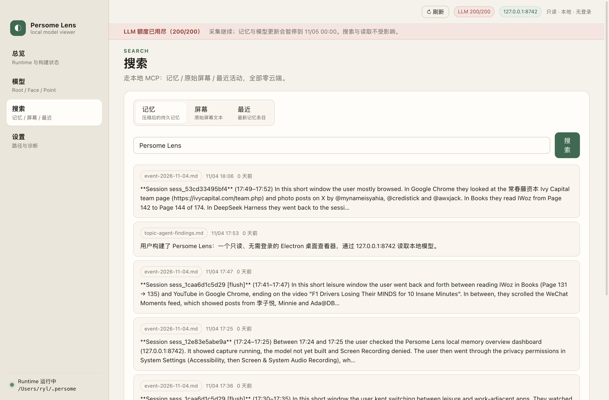
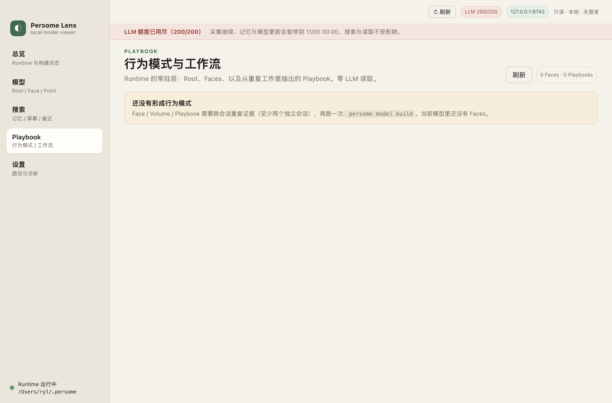
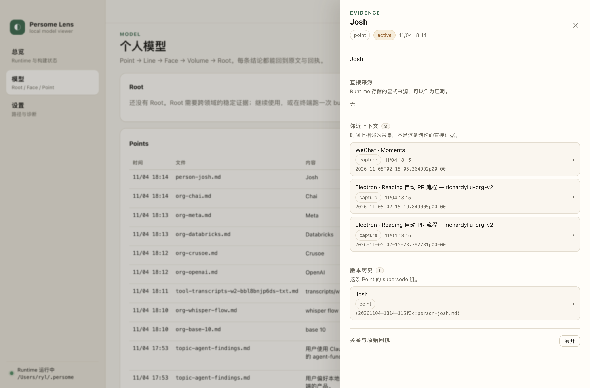
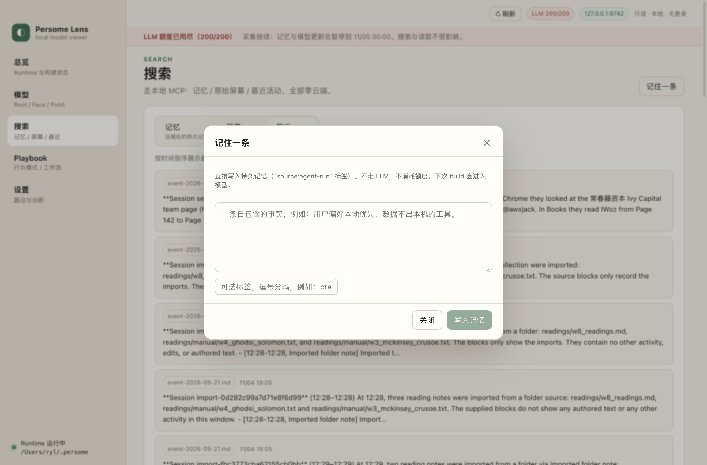

# Navalia

A local-first macOS app for the
[Persome open-source runtime](https://github.com/Intuition-Lab/personal-model).
No sign-in and no network by default; the optional self-hosted cloud features must each be turned on by you (see "Self-hosted cloud `cloud/`").

Lens v2.1 has four parts:

- **Capture.** Lens owns screen capture and its macOS permissions (TCC). The
  Runtime receives frames over `POST /captures/ingest`.
- **Model.** Lens shows the personal model the Runtime builds: Root, Faces,
  Volumes, Points, evidence, search and corrections.
- **Identity.** Lens signs a local Personal Card, shares it by Swipe, and lets
  coding agents read the model through a loopback Broker. Every read is
  recorded in an Access log.
- **HET.** Lens records completed AI work for Human Equivalent Time. The
  assessor is off by default; when the user turns it on, minutes are an LLM-backed **estimate** (see Limitations, docs/design/HET-X3.md).

The S1 round (2026-11-05, see [docs/design/GAP-vs-S1.md](docs/design/GAP-vs-S1.md))
adds the Personal Database entry points from the S1 article: a daily brief
(Today), a Library of people / projects / skills (Library), Claude Code / Codex
history import (Import), structured Workflows readable by agents, and honest
evidence / capture / HET status.

The S1-FULL round (2026-11-06, see
[docs/design/GAP-vs-S1-FULL.md](docs/design/GAP-vs-S1-FULL.md) and
[docs/design/S1-FULL-ARCH.md](docs/design/S1-FULL-ARCH.md)) adds **opt-in**
cloud features served by a self-hosted `cloud/` service: Cloud chat (Chat),
Meetings, Subscriptions (weekly-letter email subscriptions and cloud cards),
Shared moments (two-party signed shared moments) and Workflow Cloud extract; plus
connectors (Apple Health, CSV, read-only IMAP), signed / encrypted backups,
"Performance" and more local notifications.

**Default mode (local-only)**: no account, no cloud, and Lens sends no telemetry; every
socket Lens opens is on 127.0.0.1 (Runtime API, Runtime local MCP, Lens Broker 8750).
An e2e check covers this: with the cloud off, the whole process tree has no non-loopback socket within 15 s
(`tests/e2e/smoke.e2e.mjs`). Outbound connections happen **only after you turn them on**:
the `cloud/` server you enter and confirm in the cloud panel of the "Cloud chat" / "Subscriptions" / "Meetings" pages (sign-in uses the local Ed25519 identity key, with no
password / email registration), and an IMAP host you consent to separately (993, implicit TLS). The server is not
end-to-end encrypted. The list of data that leaves the machine is in `docs/design/S1-FULL-ARCH.md` §4.

## Capabilities

| Area | What it does |
|---|---|
| Capture | A native Node-API addon reads the Accessibility tree, the permission state, the frontmost app and a frontmost-window screenshot. A coordinator handles debounce, dedup and deferral, and the app supports per-app exclusions and pause. Frames go to Runtime `POST /captures/ingest`. Capture runs only when the Runtime config has `[capture] source = "ingest"`. Without Accessibility it runs degraded and sends app-switch frames without AX text. |
| Model | Root / Faces / Volumes / Points, an evidence drill-down (sources, nearby context, history, receipts), search over memory and raw captures, remember and correct, and a Playbook view. The evidence drawer separates **direct sources** from **unresolved receipts** (marked "unresolved", with the status and reason the Runtime returned — Lens never invents a reason), shows Runtime-wide gate-drop counts from `persome delta-report` labelled as global, gives copyable reproduce commands without tokens, and has an “as of” selector that accepts ISO dates / datetimes only. |
| Personal Card | A self-signed `.navaliacard` (Ed25519) built from the Runtime's scrubbed share-card projection. The private key is encrypted with macOS Keychain–backed `safeStorage`. Exports as PNG and QR; Swipe imports and verifies cards. |
| Connections | Per-agent full access to the model for Claude Code, Codex and Cursor. Lens writes their MCP config, pointing at `http://127.0.0.1:8750/mcp` with a bearer token. Claude Desktop has to be connected by pasting the config by hand. |
| Access log | One row per Broker read, grouped by day. Clearing the log does not disconnect any agent. |
| HET | Adapters read Claude Code and Codex agent logs (read-only). A segmenter splits them into tasks recorded in a local ledger (`het.db`); corrections `accepted` / `rejected` / `not_agent`; Weekly Review exports local Markdown/HTML. The same service is also served as REST `/het/*` (summary / tasks / period / activity / corrections / retry) on the Broker's loopback server (Bearer = Connection token, reads need scope `reports:read`, every request Access-logged; `src/main/het/rest.ts`, DEVIATIONS D17). Minutes need an explicit `assessorEnabled` switch **and** a real assessor transport **and** budget; since Round 4 (X3) main injects the Runtime `[agent_funding]` transport (`src/main/het/agentFundingTransport.ts`; runs `<PERSOME_ROOT>/venv/bin/python -I -B -c <fixed script>` → `agent_cli.complete`, sharing the Runtime lock and `daily_call_limit`). Default off → "Assessor off, 0 minutes". When on, minutes show as "Estimate" + anchor version, never as performance or time saved. |
| Capture diagnostics | The Capture page shows the Runtime capture source (ingest / daemon / unknown, read-only from `config.toml`), OCR on/off/policy/tier (config + loopback `/health`), Accessibility / Screen Recording state, last frame and counts, exclusions and pause, and a copyable diagnostics block with tokens and keys removed. |
| Today (daily brief) | Deterministic Markdown template, no LLM: What I did today / Next steps / To review, from recent activity, behavior patterns and the HET summary; quotes source lines, checkboxes, every inferred line marked "Unverified"; copy or export `.md`. Next steps come only from explicitly unfinished lines (`- [ ]`, `TODO:`, the Chinese "to-do:" marker) in today's and yesterday's records and verbatim learned habits, each "Unverified" with its source. It is not a Performance measure. |
| Library | People / Projects / Profile / Skills with the headline "Organized X projects and Y people", classified only from Runtime fields (Point file prefixes `person-`/`project-`, relation `*_entity_kind`); unknown kinds go to Unclassified. Profile = Root signature verbatim + top 3 Faces (Runtime order) + model counts, linking to Model. Skills = observed playbooks + imported / shared (`.navaliaskill`) / edited / externally extracted Workflows with source badges, linking to Playbook; same “N skill files. M weeks of judgment.” as Playbook. Each section fails on its own. |
| Import (history import) | Scans `~/.claude/projects` and `~/.codex/sessions` (read-only), previews sessions, stages redacted Markdown in the Lens Store (dry-run first), then runs `persome import-data --source folder --no-build`; building the model is a separate confirmed step. By default the imported Markdown keeps tool names, the first line of each command and the paths of written / edited files (redacted: the home directory is written as `~`, Runtime and Lens data directory paths are removed; tool output is never included); this can be turned off on the Import page. Each document carries front matter (`session_key`, `dedupe_key`, `turns`), and when the same session is imported again the Runtime reports unchanged (C20, DEVIATIONS D83). A "Build after import" switch (off by default, not saved, second confirmation because it calls the Runtime's LLM) chains the build after a successful import; it uses the Runtime's LLM budget (`[agent_funding]` daily cap) and shows the exit code and stderr on failure. |
| Connectors | Calendar `.ics`, health / workout CSV / JSON and Apple Health exports (`export.xml` / exported `.zip`, streamed, summarized per day), email `.eml` / mbox (one memory per message, attachments recorded by file name only, deduplicated by Message-ID), generic CSV (user-chosen column mapping), and **read-only IMAP** (app-specific password, implicit TLS on 993 only; `src/main/connectors/imap/**` is the only network code among the connectors). Each connector has its own consent (native confirm) and can be revoked; redacted content is previewed first, then written to the Runtime (remember / import-data / health-events). "Imported data" can delete the parts the Runtime supports deleting (see Limitations). No OAuth (Google / Notion / Outlook). |
| Skill sharing | "Export .navaliaskill" signs one Workflow with your identity key after Broker-grade redaction; "Import .navaliaskill" verifies offline, rejects tampered / unsigned / unknown files, stores valid ones as "Shared by others" under a new local id with the signer fingerprint, and reports "already exists" on re-import. Badges Observed / Imported / Shared by others; headline “N skill files. M weeks of judgment.” |
| Peers + weekly letter | Import friends' `.navaliacard` into a local Peers list (offline verify, tampered cards refused, updates kept as history). Shows what their card says they work on and a demoted "Keyword overlap (Unverified, not shared moments)" view: literal overlap + Runtime search + relevance threshold (a search hit is shown only if it carries a Runtime `score` ≥ 0.5, or — since today's Runtime `search` returns no score — also overlaps the card topic literally). Keyword overlap is never cited in any letter (C11). "Shared moments" panel (opt-in cloud): see the Shared moments row. Weekly letter to one friend: deterministic Markdown draft from your last 7 days plus the signed shared moments with that friend (`visibility: letters` only); copy or export, never sent from this page. Subscription folder: a local subscription folder, refreshed by hand, with an optional background periodic scan (off by default). Pick a local / iCloud Drive folder; "Refresh" imports its `.navaliacard` / `.navaliaskill` files after offline verification, skipping files already processed (sha256). Optional periodic scan, off by default: every N minutes (≥5) Lens scans only the top level of that folder (not recursive, no network) and stops when Lens quits. |
| Workflows | Playbook turns Runtime skills (`memory/skills/skill-*.md`, `behavior_patterns`) into structured Workflows (goal, inputs, tools, steps, artifacts, rules, problem→solution, evidence, provenance, version). Unmappable fields stay empty. Edits are versioned (the observed original is kept); JSON export / import is validated and deduplicated. Agents read them through the Broker tools `search_workflows` / `get_workflow`. Patterns with evidence on fewer than 3 distinct dates are shown as "Observing", not as stable habits. "Extract from session / text": copy a prompt + JSON Schema to Claude Code / Codex, paste the JSON back; Lens validates it and saves a new Workflow (badge Externally extracted). "Cloud extract" (optional cloud, C15): pick a local Claude Code / Codex session → preview, item by item, the redacted excerpts that will be sent → send only the ticked items to your `cloud/` (`task: "workflow_extract"`) → strictly validate the reply (bad JSON / out-of-range citations reject the whole reply) → save after you edit it; the source is recorded as `provenance.extraction.source = "cloud_extracted"`, with the badge "Cloud extracted", and each item shows the cited original text. Lens itself holds no LLM key and does not call a model directly. |
| Onboarding | First launch on a fresh Lens Store shows a skippable 5-step overlay: welcome / permission status / connect an agent / Import & preview (optional) / done with the Library headline. Step 4 shows the number of projects, people, skills / workflows and model Points already in the Library (up to 3 real examples each), read from the local `library.overview()`; if it cannot be read it shows "Unreadable", and with no data it is honestly empty (C23). No account, no network, no LLM. Settings → "Reopen onboarding". |
| Ask | Four copyable prompts (Who I am / This week's progress / Sort out WeChat groups / Recover a past decision) for the agent you connected in Connections, each listing the MCP tools it expects and asking the agent to cite sources and mark unverified claims. Lens does not answer and does not call an LLM. "Save an answer to memory": paste an agent's answer → Lens redacts it in main and shows exactly what will be saved → a native confirm dialog (Cancel default) → Runtime MCP `remember`. The page shows OCR status from Runtime `/health` and warns on the WeChat card when OCR is not on; when OCR is off / degraded / unknown it lists the steps with copyable commands (`persome ocr setup`, then `persome stop && persome start`). |
| Export / Restore (backup) | Settings → "Export personal database" writes `navalia-backup-<time>/`: the Runtime's redacted `persome model export` snapshot, Lens Workflows / peers / cards / settings, and a sha256 manifest; it appears only when complete. The Access log, chat history, meeting transcripts (no recordings) and shared moments can optionally be included; all are excluded by default. Optional encryption (AES-256-GCM, passphrase derived with scrypt, producing a single `.navaliabackup` file; the passphrase is not stored and cannot be recovered). The manifest is signed with your Lens identity key (`manifest.sig.json`). "Restore Lens data" first verifies everything (sha256 / every encrypted chunk / signature), lists item by item how it will restore, and asks for a second confirmation: cards are verified one by one and invalid ones skipped; **a backup signed by you (current or a previous identity)** restores every Workflow version byte for byte under the original ID, does not overwrite versions newer on this machine, and saves forks as imported copies; a backup that is unsigned / signed by someone else is restored as re-numbered imported copies (with full history); a backup with an invalid signature is rejected entirely; the Access log is archive-only (DEVIATIONS D84–D86). The identity private key, `grants.json`, cloud token / settings and the Runtime token are never included. The model snapshot is a redacted export, not the Runtime's `index.db` or captures; to keep raw data, back up `~/.persome` separately. |
| Cloud (optional, off by default) | Turned on after you enter a server address in the cloud panel of the "Cloud chat" / "Subscriptions" / "Meetings" pages (`https:`; `http://127.0.0.1` / `localhost` allowed only in unpackaged dev builds) and confirm it (native dialog in the main process); sign-in signs the server challenge with the local identity key (checking that the audience matches the configured origin), with no password / email. The token is encrypted with safeStorage, bound to the server origin and the identity fingerprint (resetting the identity signs you out), and never reaches the renderer / logs / backups. When turning the cloud off or switching servers, Lens first tries to log out the server session (3 s), then deletes the token locally; once off, no cloud request is sent. The top bar shows "Local" / "Cloud on". Settings → "Cloud" shows the server address (origin only), sign-in state and account fingerprint (truncated / hashed, never the raw value), and offers sign in, sign out, delete cloud account (native confirm in main) and the cloud switch; there is a single global switch, with no per-feature switches (DEVIATIONS D91). Code: `src/main/cloud/` (only `client.ts` calls fetch). |
| Cloud chat (Chat) | Ask your own cloud questions with the local personal database as context: the main process assembles the context from the Runtime and redacts it (≤40 items / 60 000 characters), each item is previewed before sending and can be removed, and the renderer cannot inject text; answers stream in with clickable `[ctx-N]` citations (showing the original text that was sent); "Remember this" writes to Runtime memory after a preview and a native confirm (tags `lens-chat,cloud-chat`); "WeChat group digest" sorts, per group, the WeChat content read on screen this week (search excerpts only, with the coverage stated). Conversations are stored only on this machine. Screenshots, `index.db` and tokens are never sent. |
| Subscriptions | Generates a weekly letter draft from local data (fixed template, no LLM, automatic redaction of keys / emails / local paths etc.); after editing, previews the exact bytes to be signed, and after confirmation signs it and sends it to email subscribers (server-side double opt-in; no open / read tracking; every mail has an unsubscribe link, with RFC 8058 one-click unsubscribe); shows delivery status and subscribers (emails masked); copies your own subscription link; fetches friends' weekly letters and verifies them locally (forged ones are dropped with a notice); publishes your Personal Card to the cloud or withdraws it, and fetches a friend's card by fingerprint (added to Peers after offline verification). A weekly letter can include "This week's shared moments with friends" (only entries signed by both, visible to `letters`, with dates inside the window). |
| Meetings | Recording starts only after you tick that participants have been told and confirm in a native dialog; the microphone is allowed only while recording, only for the app's own page, and only for audio; recording continues when you switch pages, with a recording banner at the top. Audio is uploaded to your cloud transcription in ~30 s chunks, and the local audio is deleted once the transcript is back on this machine; you can preview the exact Markdown and then write it to Persome memory (`persome import-data --no-build`); optionally the cloud model generates a summary from the transcript excerpts you tick. Deleting a meeting deletes the server and local copies; on an R10 Runtime (local upstream branch, `/imports/delete`) you can also click "Delete from Persome…" (native confirm) to delete the imported meeting, while on older Runtimes Lens still says it cannot be deleted per item (DEVIATIONS D89). |
| Shared moments | On a friend's page you personally propose a shared moment to one friend (title, date, place, note, visibility); once they confirm, both sides sign and each saves it locally, and both signatures are verified offline on every read; a proposal whose signer is not in Peers cannot be accepted; fixed reflection questions help you write in your own words (Lens does not write for you, and the note is not uploaded); only moments whose visibility is "Can appear in weekly letters" show up in weekly letters. Deleting by either side deletes it for both. |
| Performance (Performance view) | Only for you: per day / per week, the number of HET tasks you marked Accepted, Rejected and "Not done by an Agent", the number of `git commit` calls in Agent sessions, and your own commits in the local repos you added. Clicking any number shows every row behind it. Sources that cannot be read show "Unknown / not connected", never 0. Projects: you write the goals and milestones yourself, and Lens lists related activity, with no completion ratio and no date prediction. It is not a performance score and does not go through the Broker. |
| Proactive · Advanced | Adds three kinds of notifications on top of the X9 local notifications: meeting transcript ready, a shared moment I proposed was accepted, and last week's "Performance" counts; each kind has an "at least N evidenced entries" threshold and stays silent below it; every "send / don't send + reason" is recorded in a local decision log (no body text); optional global shortcut (conflict-checked), a "Proactive" entry in the menu bar, weekdays only, a daily cap, and a short explanation attached. All off by default; the master switch stops everything. |

Some features go beyond the original product: per-scope grants, revoke, renew,
TTL, read limits, and audit rows for denied calls. The UI labels these
**Extension**. [docs/design/DEVIATIONS.md](docs/design/DEVIATIONS.md) lists
every difference from the original product.

## Requirements

- macOS on Apple silicon (arm64)
- Node 22+ and npm
- Xcode Command Line Tools (clang), to build the native addon
- The Persome runtime: `persome` on PATH or in `~/.local/bin`, data in `~/.persome`

## Commands

| Command | What it does |
|---|---|
| `npm install` | Install dependencies |
| `npm run native:build` | Build `native/build/Release/navalia-native.node` against the Electron headers |
| `npm run dev` | Run in development (electron-vite) |
| `npm run typecheck` | TypeScript, main and renderer |
| `npm test` | Unit and contract tests (vitest; rebuilds the addon first) |
| `npm run build` | Bundle into `out/` |
| `npm run dist` | Addon, then bundle, then DMG in `dist/` (arm64) |
| `npm run e2e` | Offline end-to-end run against the dev build (`tests/e2e/smoke.e2e.mjs`) |
| `npm run e2e:packaged` | Checks on the packaged app: addon placement, fuses, signature, debug switches refused, Broker, loopback-only sockets |

If you start Lens from an Electron-based terminal that exports
`ELECTRON_RUN_AS_NODE=1`, unset it first:

```bash
env -u ELECTRON_RUN_AS_NODE npm run dev
```

The E2E run uses a temp Runtime root, a temp Lens Store, a temp agent home,
the HET fixtures in `tests/fixtures/het`, and a mock Runtime and mock MCP
backend. Each step is labelled `[real]` or `[mock]`. If another Lens already
holds port 8750, the Broker steps are reported as `SKIP` and the holder is
named. The capture steps bring a blank test window to the front for a few
seconds. Set `E2E_NO_FOCUS=1` to skip them.

### Environment overrides

| Variable | Effect | Packaged build |
|---|---|---|
| `PERSOME_ROOT` | Runtime root (default `~/.persome`) | yes |
| `PERSOME_BIN` | `persome` binary | yes |
| `LENS_STORE_ROOT` | Lens Store root | yes |
| `NAVALIA_NATIVE` | Path of the native addon | **no** (stripped: would load arbitrary code into main) |
| `LENS_AGENT_HOME`, `LENS_AGENT_APPS` | Where agent configs are detected and written | no (stripped) |
| `LENS_HET_CLAUDE_ROOT`, `LENS_HET_CODEX_ROOT` | Agent-log roots for HET (empty string disables a source) | no (stripped) |
| `LENS_BROKER_PORT`, `LENS_E2E_SAVE_DIR` | Test-only: Broker port (`0` = ephemeral), Weekly / brief / workflow export dir | no (stripped) |
| `LENS_IMPORT_HOME` | Test-only: home dir scanned by Import for `.claude` / `.codex` transcripts | no (stripped) |
| `LENS_SCREENSHOT*` | Screenshot harness (dialog hooks only in unpackaged builds) | first page only |

To run a second instance next to an installed Lens, give it its own
user-data dir; otherwise the single-instance lock makes it exit at once:

```bash
env -u ELECTRON_RUN_AS_NODE PERSOME_ROOT=/tmp/persome-test LENS_STORE_ROOT=/tmp/lens-store \
  "dist/mac-arm64/Navalia.app/Contents/MacOS/Navalia" --user-data-dir=/tmp/lens-user-data
```

## Self-hosted cloud `cloud/`

`cloud/` is an optional self-hosted service (Node 24, `node:http` + `node:sqlite`, with the only runtime dependency
`nodemailer` 10.2.1). It is **not bundled with Lens**, and Lens works fully without it. It provides device-key
sign-in, a Chat proxy (OpenAI-compatible), card relay, weekly-letter email subscriptions, meeting transcription, shared-moment relay and
the `workflow_extract` task.

For local development / trial, all third parties use mocks; no key is needed and no external request is sent:

```bash
cd cloud
npm ci
CLOUD_PUBLIC_ORIGIN=http://localhost:8787 \
CLOUD_LLM_MODE=mock CLOUD_STT_MODE=mock \
CLOUD_MAIL_MODE=outbox CLOUD_MAIL_FROM=letters@localhost.test CLOUD_MAIL_OUTBOX_DIR=./data/outbox \
  npm start
curl -s localhost:8787/health
npm test          # 118 tests, no network
```

Then, in an unpackaged Lens (`npm run dev`), set the server address to `http://localhost:8787`
(the packaged build accepts only `https:`).

- Full list of environment variables, endpoints and security notes: [`cloud/README.md`](cloud/README.md).
  Real modes need your own: `CLOUD_LLM_MODE=openai` + `CLOUD_LLM_BASE_URL` / `CLOUD_LLM_API_KEY` /
  `CLOUD_LLM_MODEL`; `CLOUD_STT_MODE=soniox` + `CLOUD_SONIOX_API_KEY`; `CLOUD_MAIL_MODE=smtp` +
  `CLOUD_SMTP_*` + `CLOUD_EMAIL_PEPPER` (**required**, ≥ 32 characters). **None** of these three real modes has been
  verified in a real environment (only against in-test fake servers).
- Production deployment: set `CLOUD_PUBLIC_ORIGIN` to the public origin and put it behind a TLS reverse proxy
  (turn on `CLOUD_TRUST_PROXY=1` only when you run your own proxy). `cloud/Dockerfile` is written but **not build-verified**.
- Architecture, data leaving the machine, retention, threat model: [`docs/design/S1-FULL-ARCH.md`](docs/design/S1-FULL-ARCH.md).
  The server is not end-to-end encrypted: the operator can read Chat (in request memory), transcripts, weekly letters, subscriber emails and shared moments.

## Layout

```
native/                Objective-C++ addon (AX tree, permissions, screenshot, events), build scripts, AX fixtures
src/main/              Electron main process
  capture/             coordinator, frame builder, ingest client, exclusions/pause settings
  identity/            keys, card schema/sign/verify, grants, Swipe, QR
  broker/              loopback MCP server, agent config writers, Access log
  het/                 adapters, segmenter, assessor, anchors, ledger, Weekly Review
  store/               Lens Store paths and permissions
  workflows/           Workflow schema, Runtime skill mapping, versioned store, external-agent extraction
  skillshare/          signed `.navaliaskill` export/import
  import/              Claude Code / Codex transcript import (redacted staging -> `persome import-data`)
  library/             Library aggregation (people / projects / portrait / skills), daily brief, next steps
  peers/               friend cards, weekly letter draft, local subscription folder
  onboarding/          first-run state
  backup/              full export (model snapshot + Lens data allowlist) and restore; crypto.ts (AES-256-GCM), signature.ts (signed manifest)
  cloud/               opt-in cloud client (client.ts is the only fetch), Chat, subscriptions / cloud cards, meetings + mic gate, shared moments
  connectors/          local connectors, consent, Apple Health, CSV; imap/ = the only network code among connectors
  performance/         "Performance": read-only het.db counts, git log of user-added repos, user projects
  proactive/           local notifications, event bus, decision log, shortcut, tray items
  s1/                  shared dependencies handed to the S1/S2 feature modules
  runtime/, mcp/       Runtime HTTP client (incl. owner-alias REST), MCP client, Ask save-answer (preview → confirm → `remember`)
  security.ts          navigation/IPC guards, app:// protocol, debug-switch refusal
src/preload/           contextBridge API (`window.lens`)
src/renderer/          React UI (src/pages/*)
src/shared/            API and types shared by main and renderer
tests/                 vitest suites per plane, e2e/, fixtures/
docs/                  design, plan, reference, deviations, security findings, test evidence
cloud/                 optional self-hosted service (Node 24, SQLite); not bundled with Lens; see cloud/README.md
```

## Data

### Lens Store

Default location: `~/Library/Application Support/Navalia`, or
`LENS_STORE_ROOT`. Directories are 0700 and files 0600.

| Path | Contents |
|---|---|
| `identity/ed25519.key.enc` | Private key, encrypted with `safeStorage` (Keychain) |
| `identity/identity.json` | Public key, fingerprint, creation time |
| `identity/previous.json` | Public records of keys retired by "Reset identity" |
| `cards/` | Issued `.navaliacard` files |
| `grants.json` | Connection grants (token hashes, not tokens) |
| `audit.db` | Access log (SQLite) |
| `het.db` | HET ledger (SQLite) |
| `het-settings.json`, `capture-settings.json`, `settings.json` | Settings (HET `assessorEnabled`/budget/transport, exclusions/pause, display name) |
| `workflows/<id>/vNNNNNN.json` | Versioned Workflows (observed v1 kept; edits and imports as new versions) |
| `peers/<fingerprint>.json` | Imported friend cards (verified on every read, ≤20 versions) |
| `import/staging/<runId>/`, `import/ledger.json` | Redacted Markdown staged for `persome import-data`; content-hash ledger of imported sessions |
| `onboarding.json` | First-run record: outcome (completed / skipped / legacy / reopened), last step, timestamps |
| `peers/subscription.json` | Subscription folder path, enabled flag, sha256 ledger of processed files (name, kind, outcome, time; no content) |
| `workflows/ext-<hash>/` | Workflows pasted back from an external agent or saved from Cloud extract (`provenance.extraction`) |
| `cloud.json` | Cloud switch and server address (default `enabled:false`; treated as off if it cannot be parsed) |
| `cloud-token.enc` | Encrypted sign-in token (safeStorage), bound to the server origin and identity fingerprint; not backed up |
| `chat/c-<id>.json` | Cloud chat: messages, snapshots of the context sent, citations, usage (local only) |
| `cloud-letters/<fingerprint>/<issue_id>.json` | Cache of verified friends' weekly letters (at most 52 per friend) |
| `meetings/<id>/{meeting.json, audio/<seq>.webm, transcript.json}` | Meeting metadata, untranscribed audio chunks (deleted after transcription), transcript |
| `moments/<moment_id>.json` | Shared moments signed by both sides + your own note |
| `performance/projects.json`, `performance/repos.json` | "Performance" projects / milestones and the repos you added |
| `proactive-decisions.json` | Proactive "send / don't send + reason" log (only categories, counts and hashed ids, no body text) |
| `connectors/consent.json`, `connectors/ledger.json`, `connectors/imap.secret.json` | Connector consent records; write ledger (content hash, Runtime entry id, health event id, timeline documents); IMAP settings (safeStorage ciphertext only) |

### Backup directory (S2-02)

`<chosen folder>/navalia-backup-<time>/` (dirs 0700, files 0600): `manifest.json`
(`navalia.backup` v4 (older versions still accepted on restore), `includes_access_log`, `includes_user_data`, sha256 + bytes per file, excluded entries with reasons),
`manifest.sig.json` (Ed25519 signature over `navalia-backup-v1\n` + canonical manifest; absent when no identity existed),
`model-snapshot.json` (Runtime `persome model export`, redacted), `lens/{workflows,peers,cards}/`,
`lens/settings.json`, `lens/het-settings.json`. `lens/access-log.json` only when "Include Access log" is ticked; chat / meeting transcripts / moments only when ticked. Never included: `identity/`, `grants.json`,
the `audit.db` file itself, `het.db`, `import/`, `cloud.json`, `cloud-token.enc`, meeting audio.
An encrypted backup is a single `navalia-backup-<time>.navaliabackup` file (`navalia.backup-enc` v1: scrypt → AES-256-GCM, 1 MiB chunks) with the same contents.

### Runtime version (deployed 2026-11-05)

| Item | Value |
|---|---|
| Runtime build | `personal-model-og` @ `462361d` (R1–R9), local tags `deploy/2026-11-05-r1r6` (`be0a0bc`), `deploy/2026-11-05-r1r7` (`03698b5`), `deploy/2026-11-05-r1r8` (`4e83ce8`), `deploy/2026-11-05-r1r9` (`462361d`, lineage backfill applied to real data: 45/49 Points and 107/187 Lines now have sources). R8 log: [docs/design/UPSTREAM-DEPLOY-R8.md](docs/design/UPSTREAM-DEPLOY-R8.md) |
| Schema | `2026-11-05.3` (migrated from `2026-08-11.4`; Runtime 0.3.2 refuses to open it) |
| Deploy status | Installed locally into `~/.persome` with `install.sh --update`. **Not pushed, no PR, no release.** Log: [docs/design/UPSTREAM-DEPLOY.md](docs/design/UPSTREAM-DEPLOY.md) |
| OCR (`/health`, 2026-11-05) | `ocr_enabled=true`, `ocr=ready`, `ocr_worker=ready`, `ocr_tier=tiny` |

Backups taken before each step (directories 0700; they contain `env` and the database, so treat them as secret):

| Path | Contents |
|---|---|
| `~/Persome Backups/20261105-145247-pre-r1r6/` | `data/` (schema `2026-08-11.4` `index.db`, `memory/`, config) + `venv-old/` (Runtime 0.3.2) + `manifest.sha256` |
| `~/Persome Backups/20261105-154335-pre-r7/` | `index.db` at schema `2026-11-05.3` + `venv-r6/` (R1–R6 venv) |
| `~/Persome Backups/20261105-173654-pre-r8/` | `data/` (index.db + wal/shm, consolidated copy, memory/, capture-buffer/, config) + `venv-r7/` (R1–R7 venv) + `manifest.sha256` |
| `~/Persome Backups/20261105-180023-pre-r9/` | same layout, taken before the R9 backfill + `venv-r8/` (R1–R8 venv) |

Rollback steps are in UPSTREAM-DEPLOY.md (DEPLOY-06 and "Rollback options now").

### Runtime files Lens reads

| Path | Purpose |
|---|---|
| `<root>/env` | Bearer token for the Runtime API, and `PERSOME_SCREENSHOT_KEY` (read in main only, to decrypt Rewind screenshots). Neither ever reaches the renderer or the logs. Screenshots returned to agents are **not** PII-scrubbed. |
| `<root>/capture-buffer/*.json` | Frames read by `rewind_frames` / `view_rewind_screenshot` |
| `<root>/config.toml` | `[mcp].port` (default 8742) and `[capture].source` |

Lens never writes the Runtime's `index.db`. It changes Runtime data only
through the Runtime's own interfaces: the ingest API, the MCP `remember` and
`correct_memory` tools, `persome import-data` / `persome model build`, and for
connector deletion `POST /health-events/import` (`deleted_events`) and
`POST /model/edit` (`retire`), plus, on an R10 Runtime (local upstream branch
`og/r10-version-delete`, not merged upstream), `POST /imports/delete`,
`POST /memory/entries/delete` and `POST /timeline/delete`. The proactive T5
"Runtime was upgraded" check keys off `schema_revision` / `build_version` from
`/health` when present (DEVIATIONS D89/D90).

Connected agents get **full access** through the Broker: all 22 Runtime MCP tools
under their own names (including the write tools `remember`, `correct_memory`,
`process_pending_model_work`, and since schema `2026-11-05.3` the read tool
`owner_aliases`), three Rewind tools (`search_rewind`,
`rewind_frames`, `view_rewind_screenshot`; shapes are Lens-defined) and four Lens
extensions (`card_get`, `usage_report`, and the read-only S1 tools
`search_workflows` / `get_workflow`, scope `model:search`): 22 + 3 + 4 = 29 tools. Tools that may spend LLM budget are
refused unless the agent budget is enabled and has calls left. Every call is in
the Access log. See DEVIATIONS D19, D26 and D55–D57; deploy deviations are D50–D54.

**Owner aliases.** The Runtime proposes names / accounts that may be the user; an alias
becomes active (resolves to self in `entity_graph`) only after the user confirms it, and a
rejected alias is not reopened by later suggestions. Lens reads them through
`GET /owner-aliases` and confirms / rejects through `POST /owner-aliases/{confirm,reject}`,
each behind a native dialog (Cancel default). For a scoped grant the Broker tool
`owner_aliases` needs `model:search` (not the public `identity:read`); without
`evidence:read` rows pass a fixed field allowlist with `evidence: []`. The alias `note`
field does not cross IPC. Real data had 0 aliases in every status on 2026-11-05.

### Trust boundaries

- Tokens, the private key and all Runtime calls stay in the main process. The
  renderer is sandboxed, with context isolation and a strict CSP
  (`connect-src 'self'`). It talks to main through an IPC allowlist that
  validates every payload with zod and checks the sender.
- The packaged app uses hardened Electron fuses: no `ELECTRON_RUN_AS_NODE`, no
  `NODE_OPTIONS`, no `--inspect`, asar integrity validation, app code loaded
  only from asar, and no extra privileges for `file://`. The renderer is served
  from `app://lens/`. A packaged build refuses to start with `--remote-debugging-port`,
  `--remote-debugging-pipe`, `--inspect`, `--inspect-brk` or `--inspect-port`.
- The Personal Card is self-signed. Verifying it proves the card is intact and
  matches its key; it does not prove who the holder is. Compare the
  fingerprint.
- Cloud (opt-in): only `src/main/cloud/client.ts` makes cloud requests, and only
  while the cloud is on; the bearer token and the identity private key never
  reach the renderer. Everything sent is first shown to you (context items,
  exact signed bytes of letters / cards / moments, consent before recording).
  Microphone access is denied unless a consented meeting is recording, and then
  only audio for the app's own page (`src/main/cloud/meetings-mic-gate.ts`).
- Capture runs inside Lens itself through the native addon. There is no
  `mac-ax-helper` fallback process, so Lens is the only app that asks for, and
  holds, the Accessibility and Screen Recording permissions.

## Limitations and blocked items

- **Signing and notarization: blocked.** The DMG is ad-hoc signed (bundle id
  `dev.navalia.app`). There is no Developer ID certificate and no
  notarization. Gatekeeper blocks a downloaded copy until the user allows it
  in System Settings.
- **TCC grants and rebuilds.** For an ad-hoc signed app, macOS ties
  Accessibility and Screen Recording grants to that exact build, so they may
  have to be granted again after an update. Until both are granted, capture
  runs degraded: no AX text, no screenshots. This happened for real on
  2026-11-05/06 (frames kept flowing, 0 with text, every timeline block
  `metadata_only`). The Capture page now shows frames / text frames / coverage
  and a red banner with "Open System Settings" when frames arrive without text, plus the
  reason a screenshot was not attached (e.g. `screen_recording_denied`).
  `bash scripts/verify-capture-text.sh` prints per-day counts only (no titles,
  URLs or text) from `~/.persome/index.db`, read-only, and exits 2 when the
  latest day has captures but no text. After re-granting, remove and re-add the
  app in both lists rather than toggling the old entry. See
  `docs/design/BLOCKED-BURNDOWN.md` B1/B18.
- **HET minutes are an estimate, and off by default.** X3 is approved
  (DECISIONS-ROUND4 R4-1). The assessor runs only when the user turns on
  "Allow assessment" on the HET page, the Runtime python exists, and
  `[agent_funding]` is enabled and not exhausted; HET's own caps (5/tick,
  20/day) apply on top. By default the prompt carries only ids, counts, tool
  names, signals and file types; sending summaries is a separate opt-in with a
  native confirm. The LLM returns buckets only; minutes come from versioned
  anchors. With no adoption signal the weight is 0.3, so most estimates are
  deliberately low. They are not a performance score and not time saved.
  HET never uses the cloud LLM. In packaged builds `LENS_HET_FAKE_ASSESSOR` is
  ignored at runtime.
- **"Performance" is counts and activity, not a score.** Option A (time saved) is not
  built. X4 option B ("AI work counts this week" on Home, and the "Performance" page) shows
  counts only to the owner and links each number to its rows; option C is an
  activity list against your own goals, with no completion ratio and no dates
  (`docs/design/PERFORMANCE.md`). "git commit in sessions" counts `git commit`
  calls in transcripts, not confirmed commits, and HET keeps a bounded set of
  evidence per task, so it may undercount. Project activity from memory uses
  Runtime search (top 20 per keyword, then a literal filter). Tested on fixture
  data only.
- **Local notifications (X9) are opt-in and off by default.** They need the
  switch in Settings; at most 3 per local day, quiet hours default 22:00–09:00,
  no body text in the notification, no network. The C17 additions (event
  triggers, context gate, decision log, global shortcut, tray items) are also
  off by default. None of this has been run against the real Notification
  Center, menu bar or global shortcut registry, only against fakes.
- **Lens holds no LLM key and calls no model directly.** "Ask" and the
  external Workflow extraction hand a prompt to an external agent. The opt-in
  cloud features (Cloud chat, meeting summaries, Cloud extract) send previewed content to *your*
  `cloud/`, and the server calls the LLM. Those paths have been tested only with
  the mock LLM / a fake OpenAI-compatible upstream, never a real provider.
  WeChat content is limited to what was on screen and captured
  (AX / OCR) within the retention window; no WeChat database is read. WeChat
  exposes almost no Accessibility text, so without OCR there is essentially no
  WeChat text. Capture and Ask show the Runtime `/health` OCR fields and, when OCR
  is off, the steps to enable it (`persome ocr setup`, which writes
  `[capture] enable_ocr_fallback / ocr_policy / ocr_tier`, then a Runtime restart).
  Lens never edits `config.toml`; its "Restart Runtime…" button asks first.
- **"Save an answer to memory"** saves the pasted text verbatim minus redactions
  (heuristic, errs toward removing too much; an env / credential dump is refused),
  with a provenance header and tags `ask-answer,external-agent`; the Runtime adds
  `source:agent-run`. Lens does not check whether the answer is true.
- **Backups** exclude the identity key, grants, HET ledger, import staging and
  cloud token / settings, and include the Access log, chat, meeting transcripts
  or moments only when you tick them (default off; the manifest records it).
  Encryption is optional; a lost passphrase cannot be recovered. The model
  snapshot is archive-only (restore it on the Runtime side); the Access log is
  archive-only (never written back to `audit.db`). Workflows come back under
  their original ids with full history **only from a backup signed by your own
  identity**. Because the private key is never in a backup, restoring on a new
  machine (new identity) brings Workflows back as re-stamped `imp-*` copies with
  full history (DECISIONS S1F-11). `peers/subscription.json` and
  `onboarding.json` are machine-local and not backed up.
- **Cloud is not end-to-end encrypted.** The server operator can read chat
  content (in request memory), transcripts, weekly letters, subscriber
  addresses and shared moments. Turning the cloud off stops all requests but
  does not delete server data; deletion is a separate action per feature
  (delete a meeting, unpublish the card, delete a shared moment, remove a
  subscriber). Deleting the whole cloud account (`DELETE /v1/account`) is
  implemented in the client and IPC (`window.lens.cloud.deleteAccount`, native
  confirm) but, as of 2026-11-06, no page has a button for it. If the logout request fails when you turn the cloud off, the
  server session stays valid until it expires (30 days by default).
- **Not verified in a real environment:** real LLM provider, Soniox, SMTP
  delivery to a real inbox (and SPF / DKIM / DMARC), a real IMAP mailbox, the
  real microphone and MediaRecorder rotation, the Docker image. All were tested
  against in-test fakes or mock modes only.
- **Meetings.** Content written into Persome cannot be removed per meeting
  (only via bulk "Delete timeline / all memory"); deleting a meeting says so. Speaker
  labels are valid within one ~30 s chunk only (`S1@3` = S1 in chunk 3). A
  recording loses a few ms at each 30 s boundary. The server keeps transcripts
  at most 7 days.
- **Subscriptions.** A sent letter cannot be recalled. The draft is
  redacted automatically (secrets, e-mail, local paths, phone / ID numbers) but
  names and ordinary text are not; check it before publishing.
- **Shared moments** need the friend's card in Peers first. Deleting removes
  the moment for both on the server; the friend's local copy goes away when
  they sync and confirm.
- **Connectors.** No OAuth (Google / Notion / Outlook). IMAP supports app
  passwords on port 993 (implicit TLS) only. With the Runtime's default
  markdown write authority, memories written by `remember` cannot be deleted
  per item, and imported timeline documents cannot be deleted by source; Lens
  lists what remains and how to remove it by hand. Apple Health aggregates
  common types only (cumulative types: the largest single source per day).
- **Subscription folder** imports skills only from friends already in Peers
  (import their card first, or drop it in the same folder). Local subscription folder, refreshed by hand; optional background periodic scan (off by default):
  the periodic scan runs the same refresh on the same folder only after you turn it
  on (interval 5 min – 24 h, default 30 min). Top level only, no network, no
  symlinks, iCloud files must be downloaded, ≤2 MB per file, ≤200 files per refresh.
- **Onboarding** is shown only on a fresh Lens Store; existing users can reopen it
  from Settings.
- **Capture L2/L3 (CAP-01/08/09)** need a person to accept the macOS TCC prompts
  (Accessibility, Screen Recording) on the packaged app by hand; they cannot be
  automated. Checklist in `docs/upstream/CAPTURE-L2L3.md`.
- **Evidence chain: backfilled, with gaps.** New Points / Lines record lineage
  in `model_candidate_points` / `relation_edge_evidence` (R1). Objects built
  under Runtime 0.3.2 were linked by the deterministic R9 backfill
  (`persome model backfill-lineage`, no LLM): 45/49 Points and 107/187 Lines now
  have direct sources. `persome model build` does not backfill old objects. Still
  without candidate sources: 4 `remember` facts (their source is their own
  entry), 42 event-occurrence Lines, 3 closed Lines. `as_of` (MOD-12) is
  unchanged by the backfill; a bare date means 00:00 local.
- **Workflow structure (R8): deployed, not yet observed on real data.** The
  Runtime can write evidence-backed Steps / Artifacts / Rules / Problems, but
  the real model has 0 skills and the Runtime LLM daily cap was used up on
  2026-11-05, so no real structured Workflow exists yet.
- **Restart other MCP clients after a Runtime upgrade.** Claude Code / Codex /
  Cursor sessions keep their old `persome mcp` stdio process, which runs the old
  code and cannot join the new SQLite maintenance gate. Restart those sessions
  (Lens' own MCP client reconnects by itself) before they write with
  `remember` / `correct_memory`.
- **Import.** Needs the `persome` CLI. Building the model after import needs a
  Runtime LLM (`persome llm setup`); without it the build step fails and says
  so. Redaction is heuristic and errs toward removing too much; tool output and
  reasoning are not imported. Re-importing a session that grew duplicates its
  earlier content ([docs/upstream/IMPORT-SOURCE-KEY.md](docs/upstream/IMPORT-SOURCE-KEY.md)).
- **Library / brief.** Classification depends entirely on Runtime entity files
  and relation kinds; differently written names are not merged; `entity_graph`
  only resolves the person roster. The brief reads the latest 100 activity
  entries and only recognises explicit todo markers (`- [ ]`, `TODO:`, and the Chinese "to-do:" marker).
- **Workflows / habits.** Fields are filled only from what the Runtime wrote;
  today's Runtime skill entries carry Pattern / Context / Evidence, so most
  Workflows show goal, context and evidence until edited. Habit dates are
  Runtime write times. Since schema `2026-11-05.3` the Runtime promotes a Face to
  active only with evidence on ≥3 distinct dates and returns `observation_dates`;
  Lens labels Faces from those dates. Verified on temp roots only: real data had
  0 Faces on 2026-11-05.
- **Sharing is self-signed.** `.navaliaskill`, friend cards, weekly letters and shared moments prove integrity and the signing key, not who the sender is — compare fingerprints out of band. Exporting needs an identity (never created silently). In the default local mode nothing is sent: a friend's update arrives only as a new card file (dropped in the local subscription folder or imported by hand) and the per-friend weekly letter is a draft. With the opt-in cloud, cards and letters can be published to and fetched from your `cloud/`, and are always re-verified offline (DEVIATIONS D3 / D31 / D38 S1-FULL notes).
- **Keyword overlap** (the demoted view on a friend's page) uses literal overlap + Runtime search + a relevance threshold. The Runtime's `search` returns no relevance score (`rank` is a raw BM25 value or `0.0`, `confidence` is extraction confidence), so a search hit must also share words with the friend's card topic. It is labelled "Unverified, not shared moments" and is never cited in a letter; shared moments exist only as two-party signed moments.
- **Capture diagnostics.** Frame counts cover the current Lens run only; a
  missing or malformed `config.toml` shows "Unknown".
- The Runtime must be switched to `[capture] source = "ingest"` before Lens
  captures. With `source = "daemon"` Lens capture stays inactive and says so.
- Claude Desktop is connected by pasting the MCP JSON by hand.
- The Codex adapter has been tested on fixtures only.
- The Broker port (8750) is fixed. Only one Lens instance per user can serve
  the Broker.

Security review findings and their status are in
[docs/agents/SECURITY-FINDINGS.md](docs/agents/SECURITY-FINDINGS.md).

## Screens (v1 console)

| Overview | Model | Search |
|---|---|---|
|  |  |  |

| Playbook | Evidence | Remember |
|---|---|---|
|  |  |  |

## Design and plan

- [v2.1 design](docs/design/DESIGN.md)
- [v2.1 plan](docs/design/PLAN-v2.md)
- [Deviations from the original](docs/design/DEVIATIONS.md)
- [v1 design archive](docs/design/DESIGN-v1-archive.md)

## License / attribution

This is an unofficial third-party app. It reads data produced by the Apache-2.0 licensed open-source runtime;
no runtime code is redistributed here.
